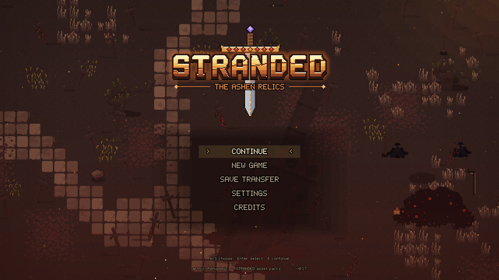
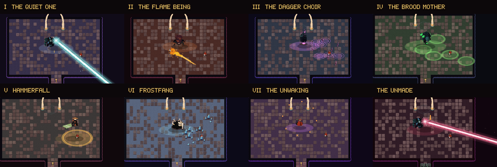
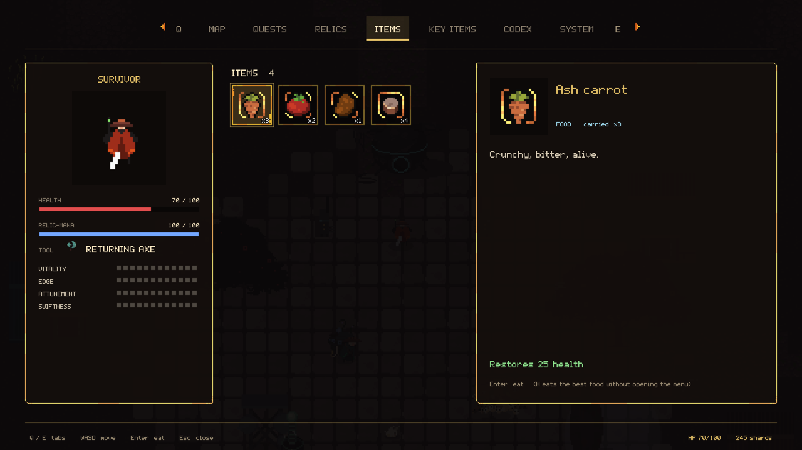

# STRANDED: The Ashen Relics

A top-down action-adventure in the spirit of Zelda. The colony-ship *Perdita* has crashed on Karush, a dead red world of ash and bone. Wake the Relic Guardians, take their hearts, and decide what to do with them. A thorough run takes about 10–15 hours.

**Website:** [stranded.detroithomelab.me](https://stranded.detroithomelab.me) · **itch.io:** [detroit-0s.itch.io/stranded-the-ashen-relics](https://detroit-0s.itch.io/stranded-the-ashen-relics)

## Download

**[Download the latest version](https://github.com/detroit0s/stranded-ashen-relics/releases/latest)** for macOS or Android. Windows players: get it from [itch.io](https://detroit-0s.itch.io/stranded-the-ashen-relics), or with the itch app, which also keeps it up to date.

### macOS

One app for both Apple Silicon and Intel Macs.

1. Download `STRANDED-v0.18-macOS.zip` and double-click it to unzip `STRANDED.app`.
2. The first time, **right-click the app ▸ Open**, then click **Open** again. The game isn't notarized by Apple, so macOS asks once.
   If it still refuses, go to **System Settings ▸ Privacy & Security** and click **Open Anyway**.

### Android

For Android 7.1 or newer, on a 64-bit phone or tablet.

1. Download `STRANDED-v0.18-android.apk` on your phone (or copy it over from a computer) and open it.
2. The game isn't on the Play Store, so Android asks first: tap **Settings**, allow installing from that app (your browser or Files), then tap **Install**. If Play Protect warns about an unknown app, choose **Install anyway**.

## What's inside

- **Karush**: 9 regions with sealed passes, beacons for fast travel and a world map, and a dozen landmarks in each: wrecks of the Perdita, skeletons of old beasts, tribe shrines, stone circles, silent machines
- **Houses you can walk into**: 14 rooms, from crew bunkhouses to fireside cabins, some with somebody at home
- **Things to cut, smash and dig up**: tall grass, pots, crates, barrels and bushes, and buried caches
- **8 dimensions and 12 Echo Rifts**: puzzle rooms floating over the void, each dungeon with a twist of its own
- **A sun that moves**: every relic-heart you take drags Karush's sun closer to dusk, and the world changes with it
- **Light and shade**: fires, lamps and Guardian beams light the ground; every region has its own light, the dungeons and the night are dark, and everything casts a shadow that grows longer as the sun sinks
- **Four Dustborn verses to sing**, **relic-hearts to wear**, fishing, a shooting range and a trading chain
- **8 Relic Guardians**, **THE UNMADE** in three shapes, and **7 mini-bosses**
- **7 relic powers**, **36 people** to meet, **21 side quests**, **7 hunts** and **73 codex entries**
- **Three difficulties**, chosen when you start a new journey, and **three endings**
- **An original soundtrack**: themes for the title, villages, dimensions and Guardian battles, ambience for every region, and 83 sound effects

## Controls

| Action | Keys |
|---|---|
| Move | WASD / arrows |
| Attack | J / Space / left-click |
| Dodge-roll | K / Shift |
| Talk, open, interact | E |
| Use relic tool / switch tool | F or right-click / R |
| Eat the best food | H |
| Sing a verse | G |
| Menu / items / map / quests | Esc / I / N / Q |

**On Android**, a stick appears under your left thumb, with on-screen buttons on the right. In **Settings ▸ Touch Controls** you can make them bigger or more see-through, swap them to the left hand, fix the stick in place, or drag each button where you like it.

**Controllers** work on every platform (Xbox, PlayStation, Switch Pro and most others): A attack, B dodge, X interact, Y relic, LB / RB switch tool / eat, LT sing, Start menu, View map. The hints show your controller's own button names.

## Credits

A game by **detroit0s**. Art: the **STRANDED** asset packs by **Penusbmic**.

This repository only hosts the game's downloads and its website (the `docs/` folder), not the game's code.

The game checks this page's `docs/version.json` (served at the website) once per session on its title screen, to tell you when a new version is out. It only fetches that small file, like opening a web page; nothing about your save is sent. You can turn it off in **Settings ▸ Check for Updates**.
