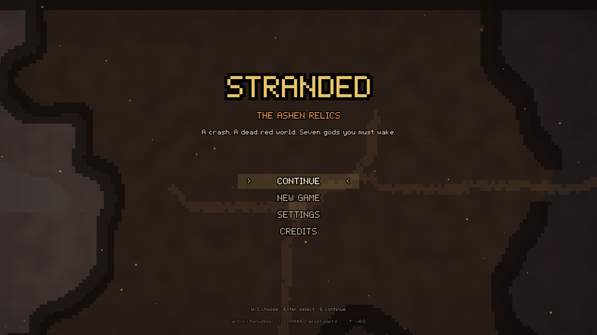
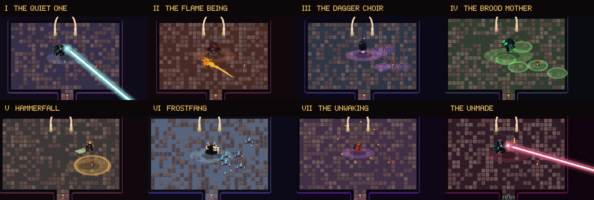
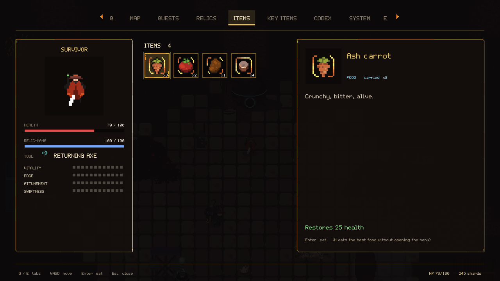

# STRANDED: The Ashen Relics

A top-down action-adventure in the spirit of Zelda. The colony-ship *Perdita* has crashed on Karush, a dead red world of ash and bone. Wake the Relic Guardians, take their hearts, and decide what to do with them. A thorough run takes about 10–15 hours.

## Download

**[Download the latest version for macOS](https://github.com/detroit0s/stranded-ashen-relics/releases/latest)**: one app for both Apple Silicon and Intel Macs.

1. Download `STRANDED-v0.7-macOS.zip` and double-click it to unzip `STRANDED.app`.
2. The first time, **right-click the app ▸ Open**, then click **Open** again. The game isn't notarized by Apple, so macOS asks once.
   If it still refuses, go to **System Settings ▸ Privacy & Security** and click **Open Anyway**.

## What's inside

- **Karush**: 9 regions with sealed passes, beacons for fast travel and a world map
- **8 dimensions and 12 Echo Rifts**: puzzle rooms floating over the void
- **8 Relic Guardians**, **THE UNMADE** in three shapes, and **7 mini-bosses**
- **7 relic powers**, **12 people** to meet, **16 side quests**, **7 hunts** and **53 codex entries**
- **Two endings**
- A tabbed menu in the style of *Breath of the Wild*, and STRANDED's own pixel font

## Controls

| Action | Keys |
|---|---|
| Move | WASD / arrows |
| Attack | J / Space / left-click |
| Dodge-roll | K / Shift |
| Talk, open, interact | E |
| Use relic tool / switch tool | F or right-click / R |
| Eat the best food | H |
| Menu / items / map / quests | Esc / I / N / Q |

## Credits

A game by **detroit0s**. Art: the **STRANDED** asset packs by **Penusbmic**.

This repository only hosts the game's downloads.
